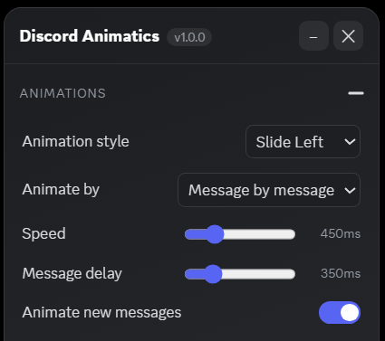

# Discord Animatics

**Animate your Discord chat. Messages slide, pop, glitch or type in, one by one, with a floating control panel to tune every detail.**

[](https://github.com/gamehuntt/Discord-Animatics)
[](https://github.com/gamehuntt/Discord-Animatics/blob/main/LICENSE)
[](#installation)
[](https://github.com/gamehuntt/Discord-Animatics/stargazers)

[Install](#installation) · [Features](#features) · [Using the panel](#using-the-panel) · [Troubleshooting](#troubleshooting) · [Contributing](#contributing)



---

## Table of contents

- [Overview](#overview)
- [Features](#features)
- [Animation styles](#animation-styles)
- [Installation](#installation)
  - [Method 1: Browser console (easiest)](#method-1-browser-console-easiest)
  - [Method 2: Discord PTB and Canary desktop apps](#method-2-discord-ptb-and-canary-desktop-apps)
  - [Method 3: Discord Stable desktop app](#method-3-discord-stable-desktop-app)
  - [Keep it for later (browser snippet)](#keep-it-for-later-browser-snippet)
- [Quick start](#quick-start)
- [Using the panel](#using-the-panel)
  - [Animations](#animations)
  - [Auto Scroll](#auto-scroll)
  - [Render](#render)
  - [Play, Stop and Start from](#play-stop-and-start-from)
  - [Shortcuts](#shortcuts)
- [How it works](#how-it-works)
- [Privacy](#privacy)
- [Troubleshooting](#troubleshooting)
- [Updating](#updating)
- [Uninstalling](#uninstalling)
- [Development](#development)
- [Contributing](#contributing)
- [Disclaimer](#disclaimer)
- [License](#license)

---

## Overview

Discord Animatics is a single-file script. You paste it into the developer console of Discord, and a small floating panel appears. From that moment, every message that appears in your chat plays an animation. You can also replay the animation for the messages already on screen.

It has 20 animation styles, three modes (message by message, word by word, letter by letter), smooth auto scrolling, and options to hide parts of the chat such as timestamps or reactions.

The script has no dependencies and no build step. It makes **no network requests** and does not touch your account or your token. It only changes how the page looks on your own screen. Other people do not see anything.

## Features

| Area                    | What you get                                                                                         |
|-------------------------|------------------------------------------------------------------------------------------------------|
| **20 animation styles** | Fade, slide, pop, bounce, blur, flip, glitch, typewriter, glow and more                              |
| **Three modes**         | Animate whole messages, single words, or single letters                                              |
| **Live preview**        | Change a setting and the animation replays by itself after a moment                                  |
| **Animate new messages**| New messages animate as they arrive, in order, without overlapping                                   |
| **Auto Scroll**         | The chat scrolls with the animation so the playing message stays at a height you choose              |
| **Set point**           | Click the chat to choose where animations play. A dashed guide line shows the spot                   |
| **Start from**          | Click any message in the chat and Play starts from that message                                      |
| **Replay animation**    | Extra entry in Discord's right-click message menu to replay one message                              |
| **Render options**      | Hide call logs, edited marks, reactions, tags, timestamps and date dividers                          |
| **Speed controls**      | Animation speed, delay between messages, word delay and letter delay                                 |
| **Floating panel**      | Draggable, collapsible, with animated sections. Show or hide it with `Ctrl`+`D`                      |
| **Saved settings**      | Your choices are remembered between sessions (when Discord allows storage)                           |
| **Clean removal**       | Running the script again replaces the old copy. One command removes everything                       |

## Animation styles

| Style       | Look                                        | Style       | Look                                         |
|-------------|---------------------------------------------|-------------|----------------------------------------------|
| Fade        | Simple fade in                              | Flip Y      | Turns in around the vertical axis            |
| Slide Left  | Slides in from the left                     | Rotate      | Spins in from a tilt                         |
| Slide Right | Slides in from the right                    | Swing       | Swings in like a hanging sign                |
| Slide Up    | Rises from below                            | Skew        | Slants in from the left                      |
| Slide Down  | Drops in from above                         | Elastic     | Stretches sideways and settles               |
| Pop         | Scales up with a small overshoot            | Glitch      | Digital glitch with colour split             |
| Bounce      | Drops in and bounces                        | Typewriter  | Reveals from left to right                   |
| Blur        | Sharpens from a blur                        | Glow        | Bright flash that fades to normal            |
| Dreamy      | Blur and rise together                      | Zoom In     | Grows in from slightly smaller               |
| Flip X      | Flips in around the horizontal axis         | Zoom Out    | Shrinks in from larger                       |

---

## Installation

The script file is here: [**discord-animatics.js**](https://raw.githubusercontent.com/gamehuntt/Discord-Animatics/main/discord-animatics.js)

> [!WARNING]
> Developer console code can do anything on your Discord page. Discord shows a warning there for a good reason. **Only paste code you trust.** This script is one readable file, and you should read it before you run it. Never run a copy from an unknown source, because someone could have changed it to do something harmful.

### Method 1: Browser console (easiest)

Nothing to install.

1. **Copy the script.** Open the [script file](https://raw.githubusercontent.com/gamehuntt/Discord-Animatics/main/discord-animatics.js). Press `Ctrl`+`A` to select everything, then `Ctrl`+`C` to copy. On macOS, use `Cmd` instead of `Ctrl`.
2. **Open Discord in your browser.** Go to [discord.com/app](https://discord.com/app) and log in. Open a server or a DM, so that messages are visible.
3. **Open the console.** Press `F12` (or `Ctrl`+`Shift`+`I`; `Cmd`+`Option`+`I` on macOS) and click the **Console** tab.
   - Make sure the console context is set to **top**.
   - On Safari, first turn on the Develop menu in **Settings → Advanced**, then press `Option`+`Cmd`+`C`.
4. **Paste and run.** Paste the script into the console and press `Enter`. If the console asks you to type `allow pasting`, type that first and paste again.
5. **Use it.** The **Discord Animatics** panel slides in at the bottom-right corner, and the console prints `Discord Animatics v1.0.0 loaded`.

The script stops when you reload the page, so paste it again each time you need it, or use the [browser snippet](#keep-it-for-later-browser-snippet) trick below.

The script works on `discord.com`, `ptb.discord.com` and `canary.discord.com`.

### Method 2: Discord PTB and Canary desktop apps

**PTB** (Public Test Build) and **Canary** are test versions of the Discord desktop app. They are separate apps, and you must log in to each one. Developer tools are normally available in these versions.

1. Download **Discord PTB** or **Discord Canary** from Discord's official download page, install it and log in.
2. Copy the [script](https://raw.githubusercontent.com/gamehuntt/Discord-Animatics/main/discord-animatics.js) (`Ctrl`+`A`, then `Ctrl`+`C`).
3. In the app, press `Ctrl`+`Shift`+`I` (`Cmd`+`Option`+`I` on macOS) and open the **Console** tab.
4. Paste the script and press `Enter`. If asked, type `allow pasting` first.

**If the developer tools do not open**, turn them on with the settings file, the same way as in [Method 3](#method-3-discord-stable-desktop-app), using the folder for your app:

| System  | PTB                                                      | Canary                                                      |
|---------|----------------------------------------------------------|-------------------------------------------------------------|
| Windows | `%APPDATA%\discordptb\settings.json`                     | `%APPDATA%\discordcanary\settings.json`                     |
| macOS   | `~/Library/Application Support/discordptb/settings.json` | `~/Library/Application Support/discordcanary/settings.json` |
| Linux   | `~/.config/discordptb/settings.json`                     | `~/.config/discordcanary/settings.json`                     |

### Method 3: Discord Stable desktop app

This is the normal Discord desktop app. Discord turns the developer tools **off** in this version, so you must turn them on first.

> [!IMPORTANT]
> Steps 1 to 4 are needed only once. Repeat **steps 5 to 7** each time Discord is fully restarted or reloaded.

**Step 1. Fully close Discord.** Right-click the Discord icon in the system tray (Windows and Linux) or the menu bar (macOS) and choose **Quit**. Closing only the window is not enough.

**Step 2. Open the settings file.**

| System          | Location of `settings.json`                                                         |
|-----------------|-------------------------------------------------------------------------------------|
| Windows         | `%APPDATA%\discord\settings.json` (press `Win`+`R`, paste the path and press Enter) |
| macOS           | `~/Library/Application Support/discord/settings.json`                               |
| Linux           | `~/.config/discord/settings.json`                                                   |
| Linux (Flatpak) | `~/.var/app/com.discordapp.Discord/config/discord/settings.json`                    |

Open the file with a plain text editor, such as Notepad or VS Code.

**Step 3. Turn on developer tools.** Add the new line inside the curly braces. Make sure the line before it ends with a comma. Then save the file.

```json
{
  "BACKGROUND_COLOR": "#202225",
  "DANGEROUS_ENABLE_DEVTOOLS_ONLY_ENABLE_IF_YOU_KNOW_WHAT_YOURE_DOING": true
}
```

Your file may already contain other settings. Keep them, and only add the new line.

**Step 4. Start Discord again.**

**Step 5. Copy the script.** Open the [script file](https://raw.githubusercontent.com/gamehuntt/Discord-Animatics/main/discord-animatics.js), press `Ctrl`+`A` and copy it.

**Step 6. Open the developer tools.** Press `Ctrl`+`Shift`+`I` (`Cmd`+`Option`+`I` on macOS) and click the **Console** tab.

**Step 7. Paste and run.** Paste the script and press `Enter`. If asked, type `allow pasting` first. The panel appears at the bottom-right corner.

> [!NOTE]
> A Discord update can reset `settings.json`. If the developer tools stop opening after an update, repeat steps 1 to 4.

### Keep it for later (browser snippet)

In Chrome and Edge you can save the script once and run it again with one click, instead of copying it every time.

1. Open Discord in the browser and press `F12`.
2. Open the **Sources** tab, then the **Snippets** section in the left sidebar. If you cannot see it, click the `»` button.
3. Click **New snippet**, name it `Discord Animatics` and paste the script into the editor.
4. Press `Ctrl`+`Enter` to run it. Next time, open the same snippet and press `Ctrl`+`Enter` again.

---

## Quick start

1. Run the script and open any chat that has messages.
2. In the panel, open **Animations** and choose an **Animation style**, for example *Glitch*.
3. Press **Play** to see it on the messages you can see.
4. Choose how it plays in **Animate by**: *Message by message*, *Word by word* or *Letter by letter*.
5. Leave **Animate new messages** on, then send or receive a message to see it animate live.

## Using the panel

The panel has a title bar and three sections you can open and close by clicking their titles. The `–` button collapses the whole panel, and the `✕` button hides it. Drag the title bar to move the panel. Press `Ctrl`+`D` to bring it back.

### Animations

| Setting                  | Range or choices                      | What it does                                                         |
|--------------------------|---------------------------------------|----------------------------------------------------------------------|
| **Animation style**      | 20 styles                             | The look of the animation                                            |
| **Animate by**           | Message, Word, Letter                 | Whether the whole message, each word, or each letter animates        |
| **Speed**                | 150 to 1500 ms                        | How long one animation lasts                                         |
| **Message delay**        | 50 to 1500 ms                         | Pause between one message and the next                               |
| **Word delay**           | 30 to 400 ms                          | Pause between words (shown in Word mode)                             |
| **Letter delay**         | 10 to 150 ms                          | Pause between letters (shown in Letter mode)                         |
| **Animate new messages** | On or off                             | Turn it off to animate only when you press Play                      |

> [!NOTE]
> In Word and Letter mode, long messages are sped up automatically so a single message never takes much longer than about 3.5 seconds.

### Auto Scroll

When **Scroll with animation** is on, the chat scrolls smoothly so the message that is about to animate sits at the height you choose.

| Setting                         | Range or choices          | What it does                                                                        |
|---------------------------------|---------------------------|-------------------------------------------------------------------------------------|
| **Scroll with animation**       | On or off                 | Turns auto scrolling on                                                             |
| **Sync scroll with animation**  | On or off                 | Scroll speed follows the animation speed. Turn it off to set the speed yourself     |
| **Point height**                | 5 to 95 %                 | Where in the chat the animation plays (0 is the top, 100 is the bottom)             |
| **Messages to animate**         | 2 to 40                   | How many of the latest messages animate one by one. Older ones appear instantly     |
| **Scroll speed**                | 0 to 2500 ms              | Scroll time per message. Only shown when sync is off                                |

Buttons in this section:

| Button        | What it does                                                                                   |
|---------------|------------------------------------------------------------------------------------------------|
| **Set point** | Click anywhere in the chat to set the point height. A dashed line follows your mouse           |
| **Reset**     | Puts the point height back to the default (50 %)                                               |
| **Latest**    | Scrolls to the newest message                                                                  |

New live messages are not scrolled to if you have scrolled far up to read older messages, so the script never pulls you away from what you are reading.

### Render

Each switch controls one part of the chat. Turn a switch **off** to hide that part.

| Switch          | Hides when off                                          |
|-----------------|---------------------------------------------------------|
| Call logs       | Messages such as "started a call" and "missed a call"   |
| Edited mark     | The "(edited)" label                                    |
| Reactions       | Emoji reactions under messages                          |
| Tags            | Bot tags, clan tags, role dots and role icons           |
| Timestamps      | The time next to each message                           |
| Date dividers   | The lines that show the date between messages           |

### Play, Stop and Start from

| Control        | What it does                                                                                           |
|----------------|--------------------------------------------------------------------------------------------------------|
| **Play**       | Replays the animation. Without Auto Scroll it plays for the messages you can see. With Auto Scroll it plays for the latest messages |
| **Stop**       | Stops the running animation right away and shows all messages normally                                 |
| **Start from** | Click a message in the chat. The message gets a blue edge, and Play begins from it to the newest one   |
| **Clear**      | Removes the chosen start message                                                                       |

You can also right-click any message and choose **Replay animation** in Discord's own menu to replay just that message.

### Shortcuts

| Shortcut         | Action                                                       |
|------------------|--------------------------------------------------------------|
| `Ctrl`+`D`       | Show or hide the panel                                       |
| `Esc`            | Cancel **Set point** or **Start from** while picking         |
| Mouse wheel or touch scroll | Stops an auto scroll that is in progress          |

> [!TIP]
> In a normal browser, `Ctrl`+`D` bookmarks the page. While Discord Animatics is running, it takes over this shortcut for the panel.

---

## How it works

Discord Animatics watches the chat for message elements. When a new message appears, it is hidden for a moment, and then a CSS keyframe animation plays on it. Messages are played one after another in a queue, so they never overlap.

In Word and Letter mode, the text of the message is split into small pieces for the animation, and put back exactly as it was when the animation ends.

If Discord re-draws a message while it is animating (this happens often), the animation carries on instead of restarting. A watchdog makes sure no message stays hidden by mistake.

## Privacy

- The script makes **no network requests**. It does not send anything anywhere.
- It does not read, use or store your Discord token or any account data.
- It does not send, edit or delete messages. It only changes how messages look on your screen.
- Your panel settings are saved in your browser storage under the key `DiscordAnimatics_settings`. They never leave your device.

## Troubleshooting

| Problem                                         | What to try                                                                                                                              |
|-------------------------------------------------|------------------------------------------------------------------------------------------------------------------------------------------|
| Nothing appears after pasting                   | Check the console for red errors. Make sure you copied the **whole** file (`Ctrl`+`A` before copying), and that the context is `top`.   |
| The console will not accept pasted text         | Type `allow pasting` in the console, press `Enter`, then paste again.                                                                    |
| The panel is gone                               | Press `Ctrl`+`D`. You probably hid it with the `✕` button.                                                                               |
| The panel is off screen after resizing          | Press `Ctrl`+`D` twice, or run the script again. The panel is kept inside the window when you resize.                                   |
| Messages do not animate                         | Open the chat that has messages, make sure **Animate new messages** is on, and press **Play**.                                           |
| Old messages do not animate on Play             | Without Auto Scroll, only messages visible on screen animate. Scroll to them first, or turn on Auto Scroll.                              |
| Animations feel too slow or too fast            | Change **Speed** and **Message delay** in the Animations section.                                                                        |
| A hidden part (timestamps, reactions) stays visible | Make sure its switch in **Render** is off. Part of Discord's layout may have changed after an update.                                |
| Developer tools do not open in a desktop app    | For Stable, follow steps 1 to 4 of [Method 3](#method-3-discord-stable-desktop-app). For PTB and Canary, use the settings file in [Method 2](#method-2-discord-ptb-and-canary-desktop-apps). |
| Settings reset after every reload               | Your Discord version may block browser storage for scripts. Set your options again after each run.                                       |
| The script stopped working after a Discord update | Discord changes its internal page structure often. Please open an issue with the console error and your Discord version.              |
| The panel disappeared after reloading           | This is normal. Paste the script again.                                                                                                  |

## Updating

Copy the latest script from this repository and paste it again. If an older copy is running, the new one replaces it automatically. Your saved settings carry over.

## Uninstalling

Reload the page. The script lives only in the current page and leaves nothing running.

To remove it without reloading, run this in the console:

```js
window.__DYN__.destroy()
```

To also delete the saved settings:

```js
localStorage.removeItem("DiscordAnimatics_settings")
```

For Stable (and PTB or Canary, if you edited their settings), you can turn developer tools off again by deleting the added line from `settings.json` and restarting the app.

## Development

There is no build step. The project is one file: `discord-animatics.js`.

1. Open Discord in your browser and open the console.
2. Paste the edited script and press `Enter`. Running it again replaces the previous copy, so you can test changes quickly.
3. Test every animation style in all three modes, with and without Auto Scroll.

```
Discord-Animatics/
├── discord-animatics.js    the script
├── docs/                   screenshots
├── README.md
└── LICENSE
```

## Contributing

Issues and pull requests are welcome. Please follow these guidelines:

- Keep the project as one file with no dependencies.
- Do not add network requests, tracking or anything that reads account data.
- Keep the script visual only. It must not send, edit or delete messages.
- Test in more than one environment (browser, PTB, Canary or Stable) and describe where you tested in your pull request.

Ideas that would help the project:

- New animation styles
- Per-channel settings
- Screenshots and a short demo video
- Fixes for Discord layout changes

## Disclaimer

This is an unofficial project. It is not affiliated with, endorsed by, or connected to Discord Inc. "Discord" is a trademark of Discord Inc.

> [!WARNING]
> Changing how the Discord client looks or behaves can go against Discord's Terms of Service. Discord Animatics is visual only and does not automate your account, but **you use it at your own risk.** Turning on Discord's developer tools in the desktop app is also done at your own risk. The author is not responsible for any account action or other damage.

## License

Released under the [MIT License](LICENSE). Copyright © 2026 gamehuntt.

Made by [@gamehuntt](https://github.com/gamehuntt).
